<!-- ╔══════════════════════════════════════════════════════════════╗
     ║                           HERO                               ║
     ╚══════════════════════════════════════════════════════════════╝ -->
<div align="center">

<!-- Banner animasi buatan sendiri: simpan file di assets/header.svg dalam repo ini -->


<br/>


</div>


<!-- ╔══════════════════════════════════════════════════════════════╗
     ║                         WHOAMI                               ║
     ╚══════════════════════════════════════════════════════════════╝ -->
<h2 align="center">⌁ whoami ⌁</h2>

```bash
assyahid@github:~$ cat profile.json
{
  "name"      : "Assyahid",
  "role"      : ["Undergraduate Student", "Developer", "Network Engineer"],
  "building"  : "Final Year Project 🔭",
  "learning"  : ["Fullstack Development", "Network Infrastructure"],
  "goal_2026" : "Contribute more to Open Source 🥅",
  "off_screen": ["chess ♟️", "music 🎧"]
}

assyahid@github:~$ echo $MOTTO
"Ship it, break it, learn it, repeat." ✨
```

<!-- ╔══════════════════════════════════════════════════════════════╗
     ║                      CURRENTLY CARDS                         ║
     ╚══════════════════════════════════════════════════════════════╝ -->
<div align="center">

<table>
  <tr>
    <td align="center" width="33%">
      <br/>
      <b>Building</b><br/>
      <sub>Final Year Project</sub>
    </td>
    <td align="center" width="33%">
      <br/>
      <b>Learning</b><br/>
      <sub>Fullstack · Networking</sub>
    </td>
    <td align="center" width="33%">
      <br/>
      <b>Looking for</b><br/>
      <sub>Collab with creators</sub>
    </td>
  </tr>
</table>

</div>

<!-- ╔══════════════════════════════════════════════════════════════╗
     ║                        TECH STACK                            ║
     ╚══════════════════════════════════════════════════════════════╝ -->
<h2 align="center">⌁ arsenal ⌁</h2>

<div align="center">

<sub><b>LANGUAGES &nbsp;·&nbsp; FRAMEWORKS</b></sub><br/><br/>


<br/><br/>

<sub><b>DATABASE &nbsp;·&nbsp; TOOLS</b></sub><br/><br/>


<br/><br/>

<sub><b>NETWORK &nbsp;·&nbsp; INFRA</b></sub><br/><br/>

<br/>


</div>

<!-- ╔══════════════════════════════════════════════════════════════╗
     ║                         ANALYTICS                            ║
     ╚══════════════════════════════════════════════════════════════╝ -->
<h2 align="center">⌁ analytics ⌁</h2>

<div align="center">


</div>

<!-- ╔══════════════════════════════════════════════════════════════╗
     ║                          WRITING                             ║
     ╚══════════════════════════════════════════════════════════════╝ -->
<h2 align="center">⌁ latest writing ⌁</h2>

<!-- Diperbarui otomatis oleh workflow blog-post -->
<!-- BLOG-POST-LIST:START -->
- [Microservices Design - API Gateway Pattern](https://dev.to/assyahid/microservices-design-api-gateway-pattern-2dep)
- [Redis, Kafka or RabbitMQ: Which MicroServices Message Broker To Choose?](https://dev.to/assyahid/redis-kafka-or-rabbitmq-which-microservices-message-broker-to-choose-55k8)
- [2020-2021 Technology Outlook: Why Python Is Here to Stay](https://dev.to/assyahid/2020-2021-technology-outlook-why-python-is-here-to-stay-eb)
<!-- BLOG-POST-LIST:END -->

<p align="right">
  <a href="https://dev.to/assyahid"></a>
</p>

<!-- ╔══════════════════════════════════════════════════════════════╗
     ║                    BEYOND THE KEYBOARD                       ║
     ╚══════════════════════════════════════════════════════════════╝ -->
<details>
<summary><b>♟️ &nbsp;beyond the keyboard</b> <sub>(klik untuk buka)</sub></summary>
<br/>

| ♟️ Chess | 🎧 Music | ☕ Fuel |
|:---:|:---:|:---:|
| Strategi di papan,<br/>strategi di kode | Lo-fi saat ngoding,<br/>apa saja saat santai | Kopi & rasa penasaran |

</details>

<!-- ╔══════════════════════════════════════════════════════════════╗
     ║                           SNAKE                              ║
     ╚══════════════════════════════════════════════════════════════╝ -->
<br/>

<picture>
  <source media="(prefers-color-scheme: dark)" srcset="https://raw.githubusercontent.com/assyahid/assyahid/output/github-snake-dark.svg" />
  <source media="(prefers-color-scheme: light)" srcset="https://raw.githubusercontent.com/assyahid/assyahid/output/github-snake.svg" />
  
</picture>

<!-- ╔══════════════════════════════════════════════════════════════╗
     ║                          CONNECT                             ║
     ╚══════════════════════════════════════════════════════════════╝ -->
<h2 align="center">⌁ let's connect ⌁</h2>

<!-- Ganti USERNAME & EMAIL dengan data Anda -->
<div align="center">

<a href="https://linkedin.com/in/USERNAME"></a>
<a href="mailto:EMAIL@example.com"></a>
<a href="https://dev.to/assyahid"></a>
<a href="https://github.com/assyahid"></a>

<br/><br/>


</div>
